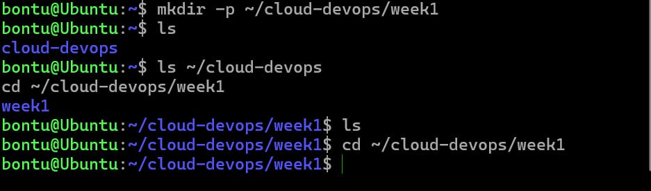
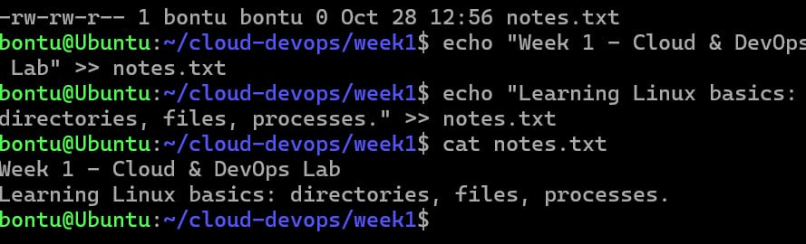

# Week 1: Linux Hands-on Lab – Project Workspace Setup

## 1. Overview

This repository documents my Week 1 practical Linux command-line exercises as part of my Cloud and DevOps learning journey.

The lab focused on developing basic Linux skills through hands-on practice, including directory creation, file management, text manipulation, file searching, and process identification.

**Objectives:**

* Understand basic Linux directory navigation.
* Create directories and files using terminal commands.
* Write text into files.
* Move files between directories.
* Locate files using the `find` command.
* Identify running processes and their Process IDs (PIDs).

## 2. Environment and Tools

| Component        | Description                       |
| ---------------- | --------------------------------- |
| Operating System | Ubuntu Linux                      |
| Environment      | Windows Subsystem for Linux (WSL) |
| Shell            | Bash                              |
| Terminal         | Windows Terminal                  |
| Version Control  | Git and GitHub                    |

## 3. Project Structure

The following structure represents the completed project:

```text
week1-linux-hands-on-lab/
│
├── README.md
│
├── screenshots/
│   ├── 01-create-directory.png
│   ├── 02-create-file.png
│   ├── 03-add-text.png
│   ├── 04-create-scripts-directory.png
│   ├── 05-move-file.png
│   ├── 06-search-file.png
│   └── 07-process-pid.png
│
└── scripts/
    └── notes.txt
```

## 4. Tasks and Implementation

### Task 1: Create the Project Directory

**Command:**

```bash
mkdir -p ~/cloud-devops/week1
```

**Explanation:**

* `mkdir` creates a directory.
* `-p` creates parent directories if they do not already exist.
* `~/cloud-devops/week1` specifies the location of the project directory.

This command established the main working directory for the lab.

**Screenshot:**



### Task 2: Create a Text File

**Commands:**

```bash
cd ~/cloud-devops/week1
touch notes.txt
```

**Explanation:**

* `cd` navigates into the project directory.
* `touch` creates an empty file named `notes.txt`.

This task introduced basic file creation and directory navigation.

**Screenshot:**



### Task 3: Add Text to the File

**Command:**

```bash
echo "My Week 1 Linux Lab" > notes.txt
```

**Explanation:**

* `echo` displays or outputs text.
* `>` redirects the output into a file.
* `notes.txt` is the destination file.

The command writes the specified text into `notes.txt`.

**Screenshot:**


### Task 4: Create a Scripts Directory

**Command:**

```bash
mkdir scripts
```

**Explanation:**

The `mkdir` command creates a new directory named `scripts` inside the current working directory.

This directory was created to organize the project files.

**Screenshot:**


### Task 5: Move the File into the Scripts Directory

**Command:**

```bash
mv notes.txt scripts/
```

**Explanation:**

* `mv` moves or renames files and directories.
* `notes.txt` is the file being moved.
* `scripts/` is the destination directory.

After executing the command, `notes.txt` was moved into the `scripts` directory.

**Screenshot:**


### Task 6: Search for the File

**Command:**

```bash
find ~/cloud-devops/week1 -name "notes.txt"
```

**Explanation:**

* `find` searches for files and directories.
* `~/cloud-devops/week1` specifies the directory where the search begins.
* `-name` searches using the specified filename.
* `"notes.txt"` is the filename being searched for.

**Expected output:**

```text
/home/<username>/cloud-devops/week1/scripts/notes.txt
```

This confirmed that the file was successfully moved into the correct directory.

**Screenshot:**


### Task 7: Identify Running Processes and Their PIDs

**Command:**

```bash
ps
```

**Explanation:**

The `ps` command displays information about currently running processes associated with the terminal.

It provides information such as:

* PID (Process ID): A unique identifier assigned to a process.
* TTY: The terminal associated with the process.
* TIME: The CPU time used by the process.
* CMD: The command or program being executed.

This task introduced basic Linux process monitoring and management.

**Screenshot:**


## 5. Key Linux Commands Practiced

| Command    | Purpose                                            |
| ---------- | -------------------------------------------------- |
| `mkdir -p` | Creates directories, including parent directories. |
| `cd`       | Changes the current working directory.             |
| `touch`    | Creates an empty file.                             |
| `echo`     | Outputs text.                                      |
| `>`        | Redirects output into a file.                      |
| `mkdir`    | Creates a directory.                               |
| `mv`       | Moves or renames files and directories.            |
| `find`     | Searches for files and directories.                |
| `ps`       | Displays running processes.                        |

## 6. Learning Outcomes

Through this hands-on exercise, I gained practical experience in:

* Navigating the Linux filesystem using terminal commands.
* Creating and organizing directories.
* Creating and modifying text files.
* Understanding output redirection.
* Moving files between directories.
* Searching for files using specific names.
* Identifying running processes and understanding PIDs.
* Working with the Ubuntu Linux environment through WSL.

## 7. Conclusion

The Week 1 Linux hands-on lab provided a practical introduction to Linux command-line operations.

By completing these exercises, I developed foundational skills in filesystem navigation, file and directory management, searching, and process identification.

These skills provide an important foundation for my continued learning in Cloud Computing and DevOps.

---

**Author:** Bontu Bekele
**Learning Track:** Cloud and DevOps
**Week:** 01 – Linux Fundamentals


